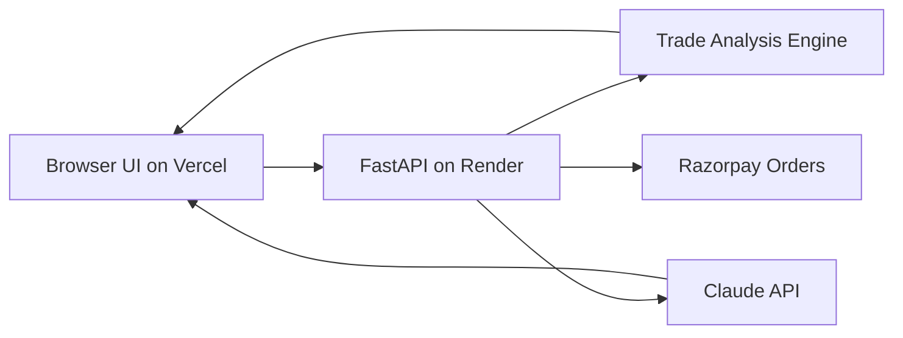

# Xtin Journal

<p align="center">
	AI-powered trading journal with analytics, behavioral insights, and a data-aware AI coach.
</p>

<p align="center">
	
	
	
	
	
</p>

## At A Glance

| Layer | Stack | Purpose |
|---|---|---|
| Frontend | HTML, CSS, Vanilla JS, Chart.js | Journal UI, analytics visuals, AI coach chat |
| Backend | FastAPI, Uvicorn, Python | API, analysis engine, AI endpoints |
| AI | Claude API + Razorpay credits | Pre-trade checks, weekly reviews, coaching replies |
| Hosting | Vercel + Render | Frontend and backend deployment |

## Core Features

- Trade logging and journal workflows
- Performance analytics with strategy-level breakdowns
- Behavioral pattern alerts for discipline and risk control
- AI coach chat with trade-context awareness
- AI pre-trade checklist and weekly review generation

## System Flow



## Quick Start

1. Install dependencies.

```bash
pip install -r requirements.txt
```

2. Create local env file.

```bash
cp .env.example .env
```

3. Set environment variables in `.env`.

```env
ANTHROPIC_API_KEY=your_claude_api_key_here
ANTHROPIC_MODEL=claude-haiku-4-5-20251001
RAZORPAY_KEY_ID=rzp_test_or_live_key_id
RAZORPAY_KEY_SECRET=rzp_test_or_live_key_secret
SUPABASE_URL=https://your-project.supabase.co
SUPABASE_SERVICE_ROLE_KEY=your_service_role_key
ALLOWED_ORIGINS=http://localhost:5500,http://127.0.0.1:5500
```

4. Start backend.

```bash
python main.py
```

5. Open `index.html` in browser (or via Live Server).

Local backend URL: `http://127.0.0.1:8001`

API docs: `http://127.0.0.1:8001/docs`

## Environment Variables

| Variable | Required | Description |
|---|---|---|
| `ANTHROPIC_API_KEY` | Yes | Claude API key used by AI coach endpoints |
| `ANTHROPIC_MODEL` | No | Defaults to `claude-haiku-4-5-20251001` |
| `RAZORPAY_KEY_ID` | Yes | Razorpay checkout key id |
| `RAZORPAY_KEY_SECRET` | Yes | Razorpay server-side secret for orders and signature checks |
| `SUPABASE_URL` | Recommended | Used by backend to persist AI token wallets |
| `SUPABASE_SERVICE_ROLE_KEY` | Recommended | Server-only key used to persist AI token wallets |
| `ALLOWED_ORIGINS` | Yes (recommended) | Comma-separated frontend origins for CORS |
| `PORT` | No | Defaults to `8001` locally |

## Deployment

### Backend: Render

Option A: Blueprint (recommended)

1. Push repo to GitHub.
2. Create a new Render Blueprint from this repo.
3. Render auto-detects `render.yaml`.
4. Set `ANTHROPIC_API_KEY`, Razorpay keys, Supabase wallet env vars, and `ALLOWED_ORIGINS`.

Option B: Manual Web Service

- Runtime: `Python`
- Build command: `pip install -r requirements.txt`
- Start command: `uvicorn main:app --host 0.0.0.0 --port $PORT`

### Frontend: Vercel

1. Import the repo in Vercel.
2. Keep the root as project directory.
3. Deploy with existing `vercel.json` SPA rewrite.

After backend deploy, set/update this in `index.html`:

```html
<meta name="backend-url" content="https://your-service.onrender.com">
```

## Production Checklist

- `GET /health` returns healthy on backend URL
- `ANTHROPIC_API_KEY` configured in Render
- `RAZORPAY_KEY_ID` and `RAZORPAY_KEY_SECRET` configured in Render
- `SUPABASE_URL` and `SUPABASE_SERVICE_ROLE_KEY` configured in Render for persistent AI credits
- `ALLOWED_ORIGINS` includes deployed frontend URL
- `index.html` meta `backend-url` points to Render service
- Frontend loads without CORS errors in browser console

## API Surface

| Method | Endpoint | Purpose |
|---|---|---|
| `GET` | `/` | Service metadata and route map |
| `GET` | `/health` | Health check |
| `GET` | `/api/v2/profile?user_id=...` | Profile scaffold response |
| `POST` | `/api/v2/analyze` | Trade analytics and insights |
| `POST` | `/api/v2/chat` | AI coaching chat |
| `POST` | `/api/v2/pre-trade-check` | AI pre-trade assessment |
| `GET` | `/api/v2/ai/plans` | AI token pack list |
| `GET` | `/api/v2/ai/wallet` | User AI token balance |
| `POST` | `/api/v2/ai/razorpay/order` | Create Razorpay order for AI credits |
| `POST` | `/api/v2/ai/razorpay/verify` | Verify Razorpay payment and credit tokens |
| `POST` | `/api/v2/weekly-review` | AI weekly review |
| `GET` | `/api/v2/behavioral-alerts?user_id=...` | Behavioral alerts scaffold |

## Useful Commands

Run backend:

```bash
python main.py
```

Run health checks:

```bash
bash health-check.sh
```

Run pre-deploy validation:

```bash
bash pre-deploy-check.sh
```

## Project Structure

```text
.
|- index.html
|- app.js
|- ai-coach.js
|- ai-coach.css
|- config-injection.js
|- main.py
|- requirements.txt
|- vercel.json
|- render.yaml
|- Procfile
|- runtime.txt
|- .env.example
|- start-server.sh
|- health-check.sh
`- pre-deploy-check.sh
```

## License

MIT
